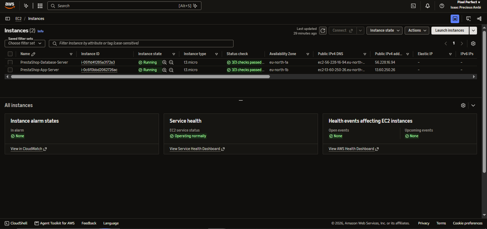
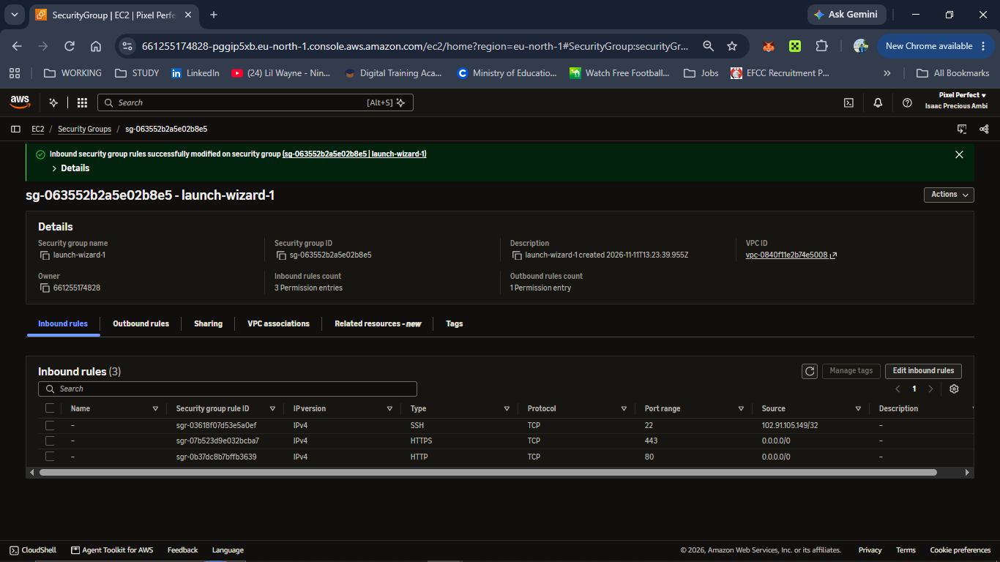
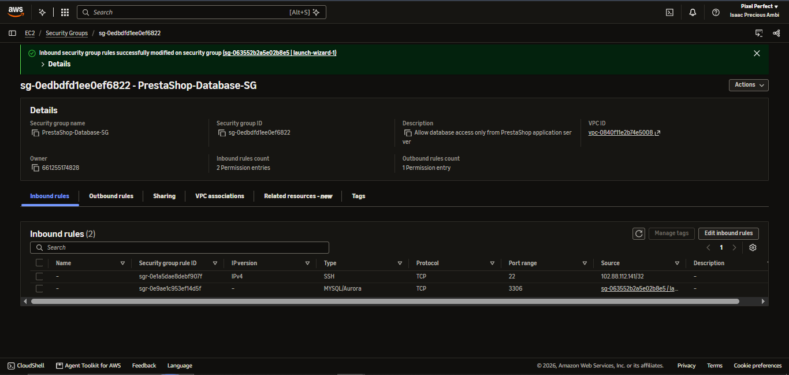
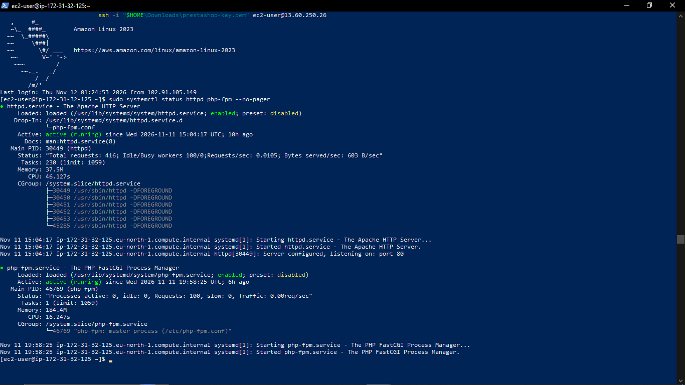
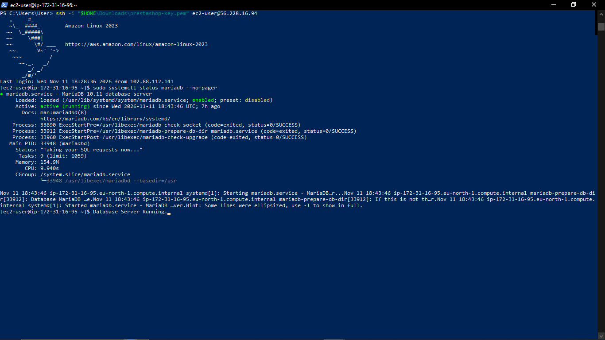
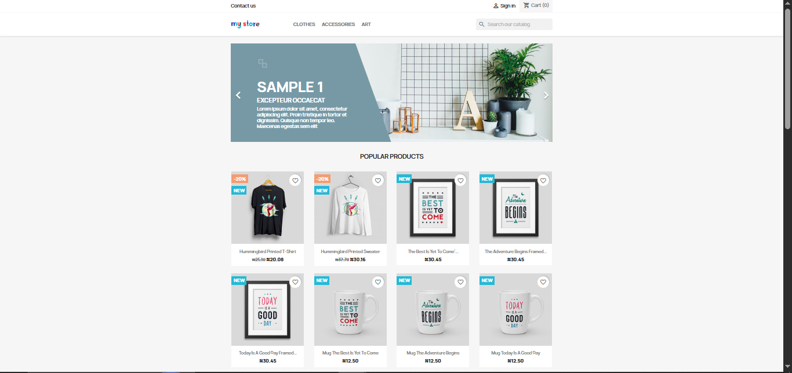
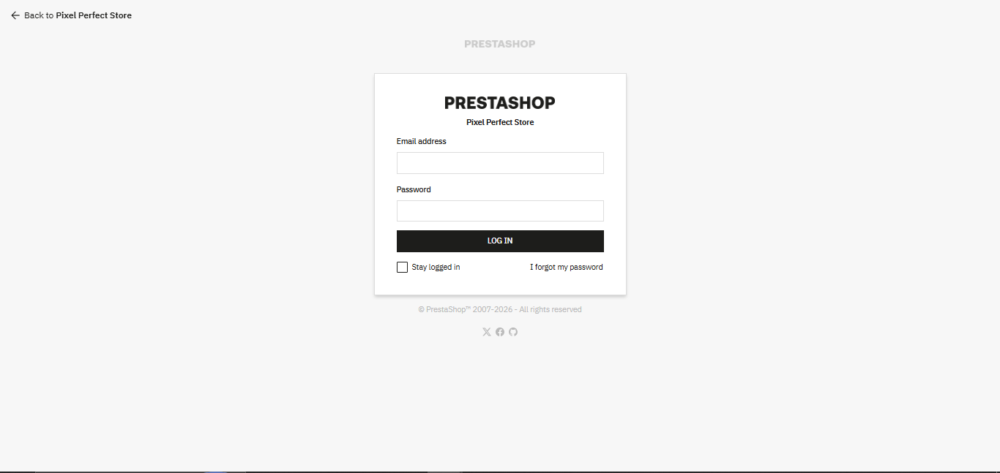

# AWS Two-Tier Deployment of PrestaShop

## Project Overview

This project demonstrates the deployment of **PrestaShop 9.2.1**, an open-source e-commerce platform, on Amazon Web Services (AWS) using a two-tier architecture.

The application and database run on separate Amazon EC2 instances. Apache and PHP power the application server, while MariaDB runs independently on the database server.

The deployment demonstrates practical experience with cloud infrastructure, Linux server administration, web server configuration, database management, network security and application deployment.

## Live Application

**PrestaShop Storefront:** http://13.60.250.26

**Store Name:** Pixel Perfect Store

## Architecture

```text
                  INTERNET
                     |
                     |
              HTTP (Port 80)
                     |
                     v
          APPLICATION EC2 INSTANCE
              Amazon Linux 2023
                     |
                Apache 2.4
                     |
                  PHP 8.5
                     |
              PrestaShop 9.2.1
                     |
                     |
          Private VPC Connection
               TCP Port 3306
                     |
                     v
           DATABASE EC2 INSTANCE
              Amazon Linux 2023
                     |
                 MariaDB 10.11
                     |
             PrestaShop Database
```

## Infrastructure and Technologies

| Component | Configuration |
|---|---|
| Cloud Provider | Amazon Web Services (AWS) |
| Region | Europe (Stockholm) – eu-north-1 |
| Application Server | Amazon EC2 – t3.micro |
| Database Server | Amazon EC2 – t3.micro |
| Operating System | Amazon Linux 2023 |
| Web Server | Apache HTTP Server 2.4 |
| PHP | PHP 8.5 |
| Database | MariaDB 10.11 |
| E-commerce Platform | PrestaShop 9.2.1 |
| Storage | 8 GiB gp3 per instance |

## Key Implementation Steps

1. Provisioned two separate EC2 instances for the application and database tiers.
2. Configured AWS Security Groups to control inbound network access.
3. Installed and configured Apache HTTP Server and PHP on the application server.
4. Installed MariaDB on the separate database server.
5. Secured MariaDB and created a dedicated PrestaShop database and database user.
6. Configured private database connectivity between the two EC2 instances.
7. Downloaded and deployed PrestaShop 9.2.1.
8. Completed the application installation using the remote MariaDB database.
9. Verified the storefront and administration login page.

## Security Configuration

- SSH access restricted to the administrator's public IP address.
- HTTP access enabled for public storefront access.
- Database access restricted to the application server's Security Group.
- MariaDB remote root login disabled.
- Anonymous database accounts and test database removed.
- Dedicated database user created for PrestaShop.
- Database credentials and SSH private keys excluded from the repository.

## Challenges and Troubleshooting

The application server experienced memory pressure during installation because of its limited RAM.

To address this:

- Configured a 2 GiB swap file.
- Increased the PHP memory limit to 512 MB.
- Optimised PHP-FPM to use an on-demand worker configuration with a maximum of two children.
- Restarted and verified the required services.

The administration login route also required troubleshooting before it loaded successfully.

## Verification

The following checks were completed:

- Both EC2 instances were provisioned.
- Apache service confirmed active.
- PHP-FPM service confirmed active.
- MariaDB service confirmed active on the separate database server.
- PrestaShop storefront successfully accessed through the public application URL.
- PrestaShop administration login page successfully accessed.

## Project Evidence

### 1. AWS Infrastructure



### 2. Application Server Security Group



### 3. Database Server Security Group



### 4. Application Services



### 5. Database Service



### 6. PrestaShop Storefront



### 7. Administration Login



## Lessons and Skills Demonstrated

- AWS EC2 provisioning and management.
- Linux command-line administration.
- Apache and PHP configuration.
- MariaDB installation and database security.
- AWS Security Groups and network access control.
- Private communication between cloud instances.
- Application deployment and troubleshooting.
- Basic cloud infrastructure security.

## Important Note

This is a demonstration deployment, not a production-hardened e-commerce environment. HTTPS/TLS was not configured. The public storefront is accessible over HTTP.

The administration login URL and credentials are intentionally not published.

---

**Project:** AWS Two-Tier PrestaShop Deployment  
**Platform:** Amazon Web Services  
**Author:** Tunecci