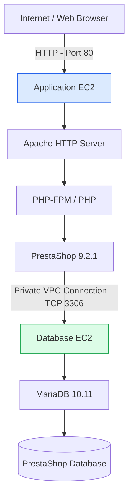

# AWS PrestaShop Two-Tier Architecture

The deployment separates the PrestaShop application and its database across two Amazon EC2 instances.

## Network Design

- The application server handles public web requests.
- Apache and PHP process the PrestaShop application.
- The database server runs separately from the application server.
- PrestaShop connects to MariaDB through the private VPC network.
- Database access is restricted to the application server's Security Group.
- SSH access is restricted to the administrator's IP address.

## Infrastructure

| Tier | EC2 Instance | Main Services |
|---|---|---|
| Application | PrestaShop-App-Server | Apache, PHP, PrestaShop |
| Database | PrestaShop-Database-Server | MariaDB |

**AWS Region:** eu-north-1 (Stockholm)